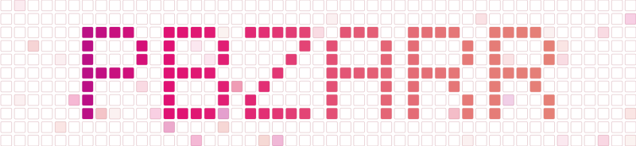

<picture>
  <source media="(prefers-color-scheme: dark)" srcset="docs/assets/pbzarr-grid-dark.svg">
  
</picture>

# pbzarr

## What is this?

pbzarr is a library for storing and analyzing genomic measurements at base-pair resolution. It stores measurements in two-dimensional arrays: one dimension for genomic position, and another for samples or other labels. You can run calculations across either dimension or both.

pbzarr uses [Zarr](https://zarr.dev/), an existing format for compressed arrays. It adds conventions for genomic coordinates and column labels, plus tools to import and analyze the data.

## Motivation

Most bioinformatics files (BAM, BED, bigWig) hold data for one sample. And this makes sense, because most primary bionformatics analyses (i.e alignment) are sample independent. But many downstream analyses need comparisons across samples, over the whole genome or in regions of interest. That means opening each sample's files, reading the relevant data, performing computations, and storing the result.

Often these analyses are exploratory. We run them several times as we decide which samples to include, which regions to look at, or where to set a threshold. With a few regions or a small sample set, this is not that big of a deal. But as cohorts and region sets grow, more work goes into reading the files and bringing the measurements together. During exploratory analysis, we can repeat that work every time we ask a slightly different question, even though the underlying measurements have not changed.

pbzarr builds on the idea that these analyses often need the same two-dimensional array: one dimension for genomic position, and another for samples. pbzarr builds this array for the whole genome once and stores it in compressed chunks using [Zarr](https://zarr.dev/). Each analysis can then read the regions and samples it needs, without rebuilding the array from individual sample files.

This also has a few useful side effects:

- [Xarray](https://docs.xarray.dev/en/stable/user-guide/data-structures.html) lets us attach genomic positions, sample names, and other labels to the dimensions, and organize different measurements together.
- [Dask](https://docs.dask.org/en/stable/array.html) lets us run calculations in parallel, on one machine or across a cluster.
- [Zarr](https://zarr.readthedocs.io/en/stable/user-guide/storage/) supports local and cloud storage. We can read the chunks we need from the cloud without downloading the whole dataset.

## Data model

pbzarr uses the [dataset model of xarray](https://docs.xarray.dev/en/stable/user-guide/data-structures.html#dataset). A `.pbz` store opens as one xarray Dataset. Each track is one variable, and all tracks share the store's reference genome and labels.

A track has at most two dimensions: genomic position and one labeled column axis, such as `sample`. The column axis is homogeneous, so every column shares the track's data type, fill value, and compression settings. When values need different data types or settings, each kind goes into its own track. For example, depth, mapping quality, and a mask become three tracks in one store.

The store fixes its reference (contig names and lengths) when it is created. Every track covers that whole reference. See [format](#format) for more details.

## Python examples

### Create a store and import d4 files

```python
import pbzarr

import pandas as pd

fai = pd.read_csv("genome.fai", sep="\t", header=None, usecols=[0, 1])
pbzarr.create("depth.pbz", reference=dict(zip(fai[0], fai[1])))
pbzarr.import_d4(
    "depth.pbz",
    "depth",
    [("brain.d4", "brain"), ("liver.d4", "liver")],
    column_dim="sample",
)
```

This creates a `depth` track with one row per genomic position and one column per sample. The store's reference must match the genome of every source exactly: the same contig names, lengths, and order.

### Read a region

```python
ds = pbzarr.open("depth.pbz")

rows = ds.reference.rows("chr1:100000-101000")
window = ds["depth"].isel(position=rows)
brain = window.sel(sample="brain")

values = window.compute()
```

`ds["depth"]` is a lazy `xarray.DataArray`. pbz uses zero-based, half-open coordinates. Use `isel` with `ds.reference.rows(...)` for genomic regions; `sel(position=...)` is reserved for a later genomic index.

### Calculate statistics over regions

```python
peaks = [
    ("chr1", 100000, 100200),
    ("chr1", 150000, 150300),
    ("chr2", 200000, 200150),
]

peak_means = ds.reduce_regions(peaks, "mean")
result = peak_means.compute()
```

The result has one mean for each peak and sample. Other reductions include `sum`, `min`, `max`, `count`, `std`, `var`, `median`, and `quantile`. Regions can also be a list of strings such as `"chr1:100000-100200"`, or a dataframe with `chrom`, `start`, and `end` columns.

Dask keeps reads and calculations lazy until `compute()`. The computed result must still fit in memory.

### Write a derived track

```python
ds = pbzarr.open("depth.pbz", mode="r+")
ds.write({"over_10": (ds["depth"] >= 10).mean("sample")})
```

A derived track must cover the whole reference on `position`, or have no genomic dimension. The write adds the track to the same store, with the default Zarr codecs unless `encoding=` says otherwise.

### Import other files

```python
reference = dict(zip(fai[0], fai[1]))

pbzarr.create("signals.pbz", reference=reference)
pbzarr.import_bigwig("signals.pbz", "signal", "sample.bw")

pbzarr.create("scores.pbz", reference=reference)
pbzarr.import_bed(
    "scores.pbz",
    "sites.bed.gz",
    genome="genome.fai",
    track="score",
    column="score",
    dtype="float32",
)
```

BED imports need a `.fai` or chromosome-sizes file because BED does not record chromosome lengths.

## CLI examples

Import a bigWig file into a `signal` track:

```sh
pbz import bigwig -o signal.pbz --track signal sample.bw
```

The import reads chromosome lengths from the bigWig header and stores values as `float32`. Uncovered bases contain `NaN`.

Import several files as labeled columns:

```sh
pbz import bigwig -o cohort.pbz --track signal -c sample brain.bw:brain liver.bw:liver
```

All sources must describe the same genome. Without explicit labels, the import uses each file's stem as its column label.

The command accepts the same import options as `pbz import d4`. These include `--file-list`, `--threads`, chunk and shard sizes, `--codecs`, and `--no-progress`.

Add samples to an existing cohort track:

```sh
pbz append bigwig -o cohort.pbz --track signal heart.bw:heart
```

Every variable over the appended dimension grows. Tracks that receive no data read their fill value in the new columns.

Preview the tracks and storage layout without writing a store:

```sh
pbz import bigwig -o cohort.pbz --track signal --file-list sources.tsv --dry-run
```

The source list contains one path per line, optionally followed by a tab and a label. If any source has a label, all sources must have labels.

## Format

A `.pbz` store is one Zarr v3 group. Tracks and coordinates are arrays directly under the root.

```text
cohort.pbz/
├── zarr.json        root attributes: pbz:version, pbz:reference
├── contig           contig names
├── contig_length    contig lengths
├── sample           column labels
├── depth            (position, sample)
└── over_10          (position,)
```

- The root attribute `pbz:reference` names the two reference arrays. Their order defines the genome: the `position` dimension is all contigs concatenated in that order.
- Offsets are not stored. The first row of contig `i` is the sum of the lengths before it, so the rows for `chr2:10-20` are that sum plus 10 up to that sum plus 20. All coordinates are zero-based and half-open.
- A column axis such as `sample` has a label array of the same name. Tracks that share it share its labels.
- Binned tracks use a `bin_N` dimension. Bins restart at each contig, so a contig's last bin can be short.

Every track declares one data type and fill value. Imported tracks are chunked and compressed with Blosc (zstd with byte shuffle) by default; imports can override the codec pipeline and chunk grid with standard Zarr v3 metadata (`--codecs` on the CLI, `codecs=` in Python). A store opens with plain xarray (`xr.open_zarr`), with no pbzarr code.

Format 0.4 stores, which used one group per track, are not readable from Python in this version. The `pbz view` and `pbz stat` commands still read them.

See the [format proposal](docs/proposals/format-05/README.md) for the full rules and the [design document](docs/DESIGN.md) for the Rust API.

## Status

pbzarr is under active development and has not reached version 1.0. The API and file rules can change. Remote writes and variable chunk sizes are planned.

## Links

- [Rust API](https://docs.rs/pbzarr)
- [Design](docs/DESIGN.md)
- [d4](https://github.com/38/d4-format)
- [Motivating issues](https://github.com/38/d4-format/issues/82): mask generation, [cross-sample compression](https://github.com/38/d4-format/issues/64), and [per-base sample statistics](https://github.com/cademirch/clam/issues/25)

## Development note

The per-base Zarr format that pbzarr standardizes was first prototyped by hand in [clam](https://github.com/cademirch/clam), where the initial concepts (the contig-major layout, cohort-shaped tracks, and the zarr/ndarray I/O path) were fleshed out before AI tooling was introduced. pbzarr lifts those concepts into a dedicated, spec-driven library.

From that point, development of pbzarr was heavily assisted by Claude (Anthropic), accelerating the library implementation, d4 import, tests, and documentation. The architecture, domain knowledge, and direction remain the author's own; Claude was used as an accelerant, not an author.
