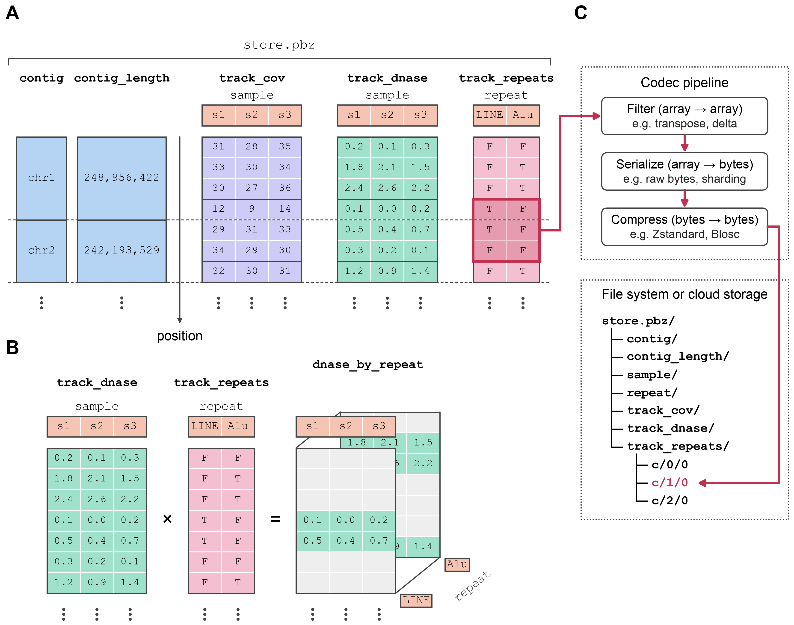

# Data model

pbzarr is a single store for genomic sequencing data that allows for joint computation and storage across data types (tracks), genomic position (`position`), and samples (column dim). For example, a single pbzarr store can be used to represent a cohort of individuals jointly for their quantitative signals (e.g., genomic coverage and DNase), while also storing categorical annotations (e.g., positions of repetitive elements) for stratification in data analysis (panel A). Importantly, this allows for arbitrary computation on or across tracks and their shared dimensions, e.g., an intersection of DNase values across a cohort with repetitive element annotations is a single matrix operation resulting in DNase values stratified by repetitive elements (panel B).

Formally, a pbzarr store is a Zarr v3 group that holds a reference genome defined by contig IDs and contig lengths, and track arrays whose first dimension runs over every base in order, followed by optional labeled dimensions such as `sample` (panel A, and the [format specification](https://github.com/pbzarr/pbzarr/tree/main/spec)). Each track is a Zarr array, which is split into blocks of consecutive positions and samples (chunks) that are compressed and stored independently (panel C). Because a pbzarr store is an ordinary Zarr store, it can be a directory on a file system, a ZIP file, or a location in cloud object storage.



**The pbzarr format.** **(A)** A pbzarr store holds a reference genome, defined by contig IDs and contig lengths (blue), and any number of tracks. Tracks share the position axis, which runs over every base in every contig in order (dashed line, contig boundary), and can hold quantitative signals (purple, green) or categorical annotations (red) along a labeled second dimension. **(B)** Intersecting the DNase track with the repeat track gives DNase values for each sample stratified by repeat class. **(C)** Each chunk of a track (red outline in A) passes through a Zarr codec pipeline and is stored as one object named by its chunk index (e.g., `c/1/0`), on a file system or in cloud object storage.

The rest of this page explains each part of a store. After you read it, you can look at `print(ds)` and name each part.

## What is in a store

A store has one reference: a list of contig names and lengths, in order. The store fixes the reference when it is created. Every track covers the whole reference.

A store opens as one [xarray Dataset](https://docs.xarray.dev/en/stable/user-guide/data-structures.html#dataset). This is a small store with two contigs and six samples:

```python
import pbzarr

ds = pbzarr.open("cohort.pbz")
print(ds)
```

```text
<xarray.Dataset> Size: 16MB
Dimensions:        (position: 320000, sample: 6, contig: 2)
Coordinates:
  * sample         (sample) object 48B 's1' 's2' 's3' 's4' 's5' 's6'
    contig_id      (contig) object 16B 'chr1' 'chr2'
    contig_length  (contig) int64 16B 200000 120000
  * reference      <U8 32B 'cca77687'
Dimensions without coordinates: position, contig
Data variables:
    depth          (position, sample) int32 8MB dask.array<chunksize=(320000, 6), meta=np.ndarray>
    mappable       (position) bool 320kB dask.array<chunksize=(320000,), meta=np.ndarray>
    signal         (position, sample) float32 8MB dask.array<chunksize=(320000, 6), meta=np.ndarray>
Indexes:
    reference  ReferenceIndex(2 contigs, cca77687)
Attributes:
    zarr_conventions:  [{'uuid': 'd5bd7bea-0388-4e0a-9844-707c034e9add', 'nam...
    pbz:version:       0.5
```

| Part | In the Dataset | What it is |
|---|---|---|
| reference | `contig_id` and `contig_length` on the `contig` dimension | contig names and lengths, in order |
| `position` | a dimension with no coordinate | every base of every contig, one after the other |
| track | a data variable whose first dimension is `position` or `bin_N` | one kind of measurement: here `depth`, `signal`, and `mappable` |
| column axis | a dimension such as `sample`, with a label coordinate of the same name | the columns of a 2D track |
| `reference` | a coordinate with no dimension | a short digest of the reference, in memory only |

The arrays are lazy. `pbzarr.open` reads the metadata only. pbzarr reads values when you call `.compute()`, `.values`, or a function that needs them.

## The reference

The reference is the arrays `contig_id` and `contig_length`. Their order defines the genome. `pbzarr.Reference.from_xarray` gives the reference as a mapping of contig name to length:

```python
ref = pbzarr.Reference.from_xarray(ds)
ref["chr1"]          # 200000
list(ref)            # ['chr1', 'chr2']
```

Each array from `pbzarr.open` also has a `reference` coordinate. It has no dimension, so it stays on the result of arithmetic and of most reductions. When you combine arrays from two stores with different references, xarray raises `AlignmentError`. This stops a silent mix of two genomes. The coordinate is in memory only. The store does not hold it.

## The position axis

`position` holds all contigs, one after the other, in reference order. Its length is the sum of the contig lengths. For the store above, `chr1` has 200,000 bases and `chr2` has 120,000 bases:

```text
row of position:  0 ........ 199,999 | 200,000 ........ 319,999
base:             chr1:0  chr1:199999 | chr2:0       chr2:119999
```

The first row of a contig is the sum of the lengths of the contigs before it.

Coordinates are 0-based and half-open, as in BED. `chr1:100-200` is 100 bases: the base at 100 is in it, and the base at 200 is not.

`position` has no label for each base. To read one locus, use `pbzarr.region`:

```python
locus = pbzarr.region(ds["depth"], "chr2:1000-2000")
```

```text
<xarray.DataArray 'depth' (position: 1000, sample: 6)> Size: 24kB
dask.array<getitem, shape=(1000, 6), dtype=int32, chunksize=(1000, 6), chunktype=numpy.ndarray>
Coordinates:
  * position       (position) object 8kB 'chr2:1000' 'chr2:1001' ... 'chr2:1998'
  * sample         (sample) object 48B 's1' 's2' 's3' 's4' 's5' 's6'
    region_contig  object 8B 'chr2'
    region_start   int64 8B 1000
    region_end     int64 8B 2000
    pos            (position) int64 8kB 1000 1001 ... 1998 1999
  * reference      <U8 32B 'cca77687'
```

The locus has labels such as `"chr2:1000"` on `position`, so `locus.sel(position="chr2:1500")` works. Its `pos` coordinate holds the contig-local positions as numbers. A region string can have these forms:

| String | Selects |
|---|---|
| `"chr1"` | all of `chr1` |
| `"chr1:1000"` | from base 1000 to the end of `chr1` |
| `"chr1:1000-2000"` | bases 1000 to 1999 |
| `"chr1:1,000-2,000"` | the same; commas are ignored |

The command line uses the same rules for `-r`. Do not select rows of `position` directly, for example with `ds["depth"][:1000]` or `isel(position=...)`. See [Common mistakes](common-mistakes.md).

## Tracks

A track is one data variable. It has one data type, one fill value, and one set of compression settings. Its first dimension is `position` (one row for each base) or `bin_N` (one row for each bin). Values of different kinds go in different tracks. For example, depth, mapping quality, and a mask are three tracks in one store.

A track has one or two dimensions:

- `(position,)`: one value for each base, for example a mask or a reference signal.
- `(position, sample)`: one value for each base and each column.

## Column axes

The second dimension of a track is a column axis. Its name is free: `sample`, `strand`, `metric`, or another name. A column axis has a label array with the same name, and the labels are unique. Tracks that use the same column axis share its labels. In the figure, `track_cov` and `track_dnase` share `sample`, and `track_repeats` uses `repeat`.

## Bins

A `bin_N` dimension holds bins of N bases, for example `bin_1000`. Bins start again at 0 in each contig, so the last bin of a contig can be short. `pbzarr.region` selects the bins that a region touches.

In this release, `pbz view` and `pbz stat` do not read tracks on a `bin_N` dimension, and `pbzarr.reduce_regions` leaves them out of its result. Use xarray for these tracks.

## Fill and null

The fill of a track is the value at bases that no source covers. A null marks a missing value. Each data type has one null:

| Data type | Null |
|---|---|
| float32, float64 | `NaN` |
| int8 to int64, uint8 to uint64 | the type maximum |
| bool | none |

Each importer fills gaps in one way:

| Importer | Value at a gap | Change it with |
|---|---|---|
| d4 | 0 | not possible |
| BAM and CRAM | 0 (no reads means depth 0) | not possible |
| bigWig | null | `--fill 0`, or `fill=0` in Python |
| BED value column | null | `--fill 0`, or `fill=0` in Python |
| BED3 mask, or a bool column | false | `--fill true` for a bool column |

Use `--fill 0` when a gap in the source means 0, as in a bedGraph that leaves out zero regions. Keep the null when a gap means "no value", as in a methylation track.

xarray reads an integer track that has nulls as a float track, with `NaN` at the nulls. A track of int8, int16, uint8, or uint16 becomes float32. A track of int32, int64, uint32, or uint64 becomes float64. If you need missing values, a float track is often simpler.

## Next steps

- [Storage layout](storage-layout.md): chunks, shards, compression, and zip stores.
- [Common mistakes](common-mistakes.md): operations that give wrong numbers with no error.
- [Store format](../reference/format.md): the rules for tools that read stores without pbzarr.
