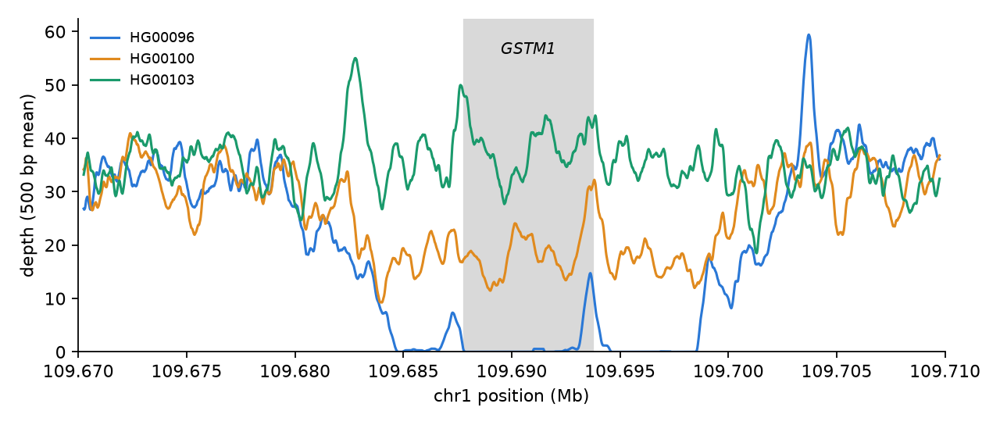
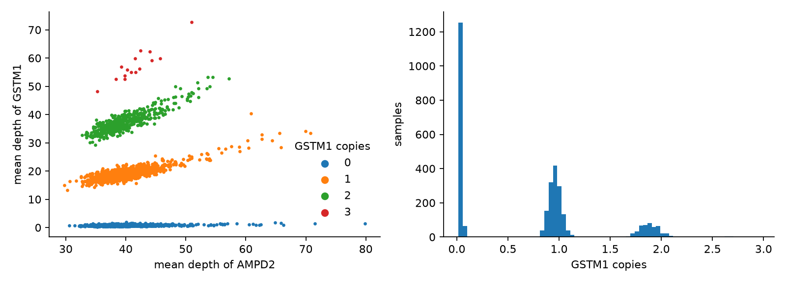

# Try a public store: 1000 Genomes depth

This page opens a public store over HTTPS and uses it. You do not download the store. Each step reads only the chunks that it needs.

The store holds the read depth at every base of GRCh38 for the 3,202 samples of the 1000 Genomes Project 30x release.

| Property | Value |
|---|---|
| URL | `https://pando-rgw.chpc.utah.edu/vollgerlab/public/pbzarr/30x-1000genomes.pbz` |
| Track | `depth`, `int32`, over `(position, sample)` |
| Positions | 3,217,346,917 (3,366 contigs of the GRCh38 analysis set with decoy and HLA sequences) |
| Samples | 3,202 |
| Size | 1.5 TiB (41 TB as an array in memory) |
| Source | The 30x CRAM files of the New York Genome Center (Byrska-Bishop et al., Cell, 2022) |

`pbz import bam` made the track. The depth counts all reads that are not unmapped, secondary, duplicate, or failed quality control. It counts the overlap of a proper pair one time, and it does not count deletions.

## Before you start

Install pbzarr. Install `aiohttp` also, which zarr-python uses to read from an HTTPS URL:

```bash
pip install pbzarr aiohttp
```

## 1. Open the store

```python
import pbzarr

URL = "https://pando-rgw.chpc.utah.edu/vollgerlab/public/pbzarr/30x-1000genomes.pbz"
ds = pbzarr.open(URL)
ds
```

```text
<xarray.Dataset> Size: 41TB
Dimensions:        (position: 3217346917, sample: 3202, contig: 3366)
Coordinates:
  * sample         (sample) StringDType() 51kB 'HG00096' 'HG00097' ... 'NA21144'
    contig_id      (contig) StringDType() 54kB 'chr1' ... 'HLA-DRB1*16:02:01'
    contig_length  (contig) int64 27kB 248956422 242193529 ... 11569 11005
  * reference      <U8 32B '15ba844d'
Dimensions without coordinates: position, contig
Data variables:
    depth          (position, sample) int32 41TB dask.array<chunksize=(65536, 512), meta=np.ndarray>
```

The open reads the metadata only, which takes about one second. The `depth` track is a lazy Dask array. No depth values come from the server until you call `compute()`.

Look at the samples and the contigs:

```python
depth = ds["depth"]
depth.sample.values[:4]      # ['HG00096' 'HG00097' 'HG00099' 'HG00100']
ds["contig_id"].values[:3]   # ['chr1' 'chr2' 'chr3']
depth.attrs["description"]
```

## 2. Read one locus

The gene *GSTM1* is absent from both chromosomes in many people. Select 40 kb around it, and read three samples:

```python
locus = pbzarr.region(depth, "chr1:109670000-109710000")
three = locus.sel(sample=["HG00096", "HG00100", "HG00103"]).compute()
```

Positions are 0-based and intervals are half-open. This step reads one inner chunk for each sample, so it takes about one second.

Plot the depth as a mean over 500 bases:

```python
three.rolling(position=500, center=True).mean().plot.line(x="pos", hue="sample")
```

HG00103 has full depth across the gene, HG00100 has half, and HG00096 has none.



## 3. Compute a statistic for all samples

Get the mean depth of *GSTM1* and of a control gene, *AMPD2*, in each of the 3,202 samples:

```python
import pandas as pd

regions = pd.DataFrame(
    {
        "chrom": ["chr1", "chr1"],
        "start": [109_687_816, 109_619_836],
        "end": [109_693_745, 109_632_051],
        "name": ["GSTM1", "AMPD2"],
    }
)
means = pbzarr.reduce_regions(depth, regions, "mean").compute()
```

`means` is an `xarray.DataArray` over `(region, sample)`. On a laptop with a home connection, this step took 3 seconds.

Divide the depth of *GSTM1* by the depth of the control, and multiply by 2, to estimate the number of copies:

```python
table = means.to_pandas().set_axis(regions["name"]).T
table["copies"] = 2 * table["GSTM1"] / table["AMPD2"]
table.round(2).head()
```

```text
name     GSTM1  AMPD2  copies
sample
HG00096   1.13  42.34    0.05
HG00097   0.68  39.29    0.03
HG00099   0.70  44.37    0.03
HG00100  18.50  37.38    0.99
HG00101   0.80  42.12    0.04
```

Count the samples at each copy number:

```python
table["copies"].round().astype(int).value_counts().sort_index()
```

```text
copies
0    1317
1    1415
2     455
3      15
```

1,317 of the 3,202 samples have no copy of *GSTM1*.

Plot the means. The left panel has one point for each sample, with a color for the copy number, rounded to a whole number. The right panel is a histogram of the `copies` column:

```python
import matplotlib.pyplot as plt

fig, (left, right) = plt.subplots(1, 2, figsize=(10, 3.6))
groups = table["copies"].round().astype(int)
for n in sorted(groups.unique()):
    rows = table[groups == n]
    left.scatter(rows["AMPD2"], rows["GSTM1"], s=4, label=str(n))
left.legend(title="GSTM1 copies", loc="lower right", bbox_to_anchor=(1, 0.04), markerscale=3, frameon=False)
left.set_xlabel("mean depth of AMPD2")
left.set_ylabel("mean depth of GSTM1")
right.hist(table["copies"], bins=70)
right.set_xlabel("GSTM1 copies")
right.set_ylabel("samples")
```



The samples make one line for each copy number. The depth of *GSTM1* increases with the depth of the control gene, and the slope of the line gives the number of copies.

## 4. Close the store

```python
ds.close()
```

## Where next

- [Depth in regions](../cookbook/depth-in-regions.md): more statistics, and regions from a BED file.
- [Compare samples](../cookbook/compare-samples.md): compare each sample with the cohort.
- [Zarr, xarray, and Dask](../concepts/zarr-xarray-dask.md): how the lazy arrays work.
